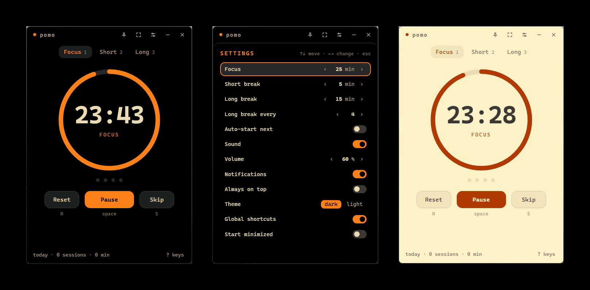
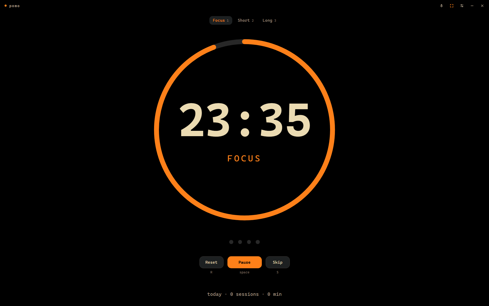

<p align="center"></p>

<h1 align="center">Pomo</h1>
<p align="center"><b>A tiny, keyboard-first Pomodoro timer for Windows.</b><br>
Flat true-black gruvbox design · 1.3 MB installer · ~0% CPU when idle</p>

<p align="center"></p>

---

## Why Pomo

Most focus timers are either bloated Electron apps or browser tabs you lose behind twenty others. Pomo is a native Windows app that sits quietly in your tray, does one thing well, and stays out of your way.

- **Keyboard-first.** Every action has a key. Press **Space** to start; you never have to touch the mouse.
- **Featherweight.** 1.3 MB installer, about 70 MB RAM including the web runtime, effectively 0% CPU when idle or hidden.
- **Accurate.** Timing is computed from timestamps, never from counting ticks, so it survives sleep, lag and background throttling. Phase ends fire on time even when Pomo is hidden in the tray.
- **Second-monitor full screen.** Drag Pomo to another screen and press **F**: a huge, calm ring on pure black that fades its controls away until you mouse over it.
- **Always in view.** Press **B** for a slim always-on-top mini bar (`● [██████░░░░] 18:42 focus`), watch progress fill Pomo's taskbar button, or glance at the tray icon's draining ring and minutes left.
- **Easy on the eyes.** Flat gruvbox palette on true black (great on OLED), plus a warm light theme.
- **Private.** No account, no telemetry, no network access. Your settings and stats never leave your PC.

## Features

| | |
|---|---|
| **Pomodoro cycle** | Focus 25 · Short break 5 · Long break 15, long break after every 4 focus sessions. All adjustable (1–180 min). |
| **Auto-start** | Optionally roll straight into the next phase. |
| **Gentle alerts** | Windows notification + a soft synthesized chime (volume control, one-key mute) + a window pulse. |
| **Mini bar** | `B` shrinks Pomo to a one-line, CLI-style strip that stays on top. Drag it anywhere (e.g. just above the taskbar); double-click, `B` or `Esc` to expand. |
| **Taskbar progress** | Pomo's taskbar button fills as the phase runs and turns yellow when paused. |
| **Live tray icon** | The tray icon becomes a draining ring in the phase colour with the minutes left; live `MM:SS · Focus` tooltip; left-click to show/hide; menu with Start/Pause, Skip, Quit. Tip: drag the icon out of the `^` overflow to keep it next to the clock. |
| **Global hotkeys** | `Ctrl+Alt+Space` start/pause and `Ctrl+Alt+P` show/hide from any app (can be turned off). |
| **Daily stats** | Today's completed sessions and focus minutes, reset at local midnight. |
| **Always on top** | Pin the window above everything with **P**. |
| **Start minimized** | Launch straight to the tray. |
| **Themes** | Dark (true black) and light, with smooth transitions. |
| **Accessibility** | Fully keyboard-operable settings, visible focus rings, honors *reduce motion*. |

## Install

1. Download **`Pomo_1.1.0_x64-setup.exe`**.
2. Run it. It installs for your user only, so no admin rights are needed.
3. Launch **Pomo** from the Start menu.

> **"Windows protected your PC"?** The installer isn't code-signed yet, so SmartScreen may warn on first run. Click **More info → Run anyway**.

**Requirements:** Windows 10 or Windows 11, 64-bit. Pomo uses the Microsoft Edge WebView2 runtime, which is built into Windows 11 and most up-to-date Windows 10 PCs; if it's missing, the installer downloads it automatically.

**Uninstall:** *Settings → Apps → Installed apps → Pomo → Uninstall*.

## Using Pomo

| Key | Action | Key | Action |
|---|---|---|---|
| `Space` | Start / pause | `,` | Settings |
| `R` | Reset phase | `M` | Mute / unmute |
| `S` | Skip phase | `P` | Always on top |
| `1` `2` `3` | Focus / Short / Long | `F` / `F11` | Full screen (current monitor) |
| `?` | Shortcut overlay | `B` | Mini bar (always on top) |
| `Esc` | Close panel / exit full screen or mini | | |
| `Ctrl+Q` | Quit | `Ctrl+Alt+Space` · `Ctrl+Alt+P` | Global start/pause · show/hide |

**Settings** (press `,`): use `↑` `↓` to move, `←` `→` (or `-` `+`, hold `Shift` for ×5) to change, and `Enter`/`Space` to toggle. Changes save instantly.

**Closing the window** with `×` hides Pomo to the tray; the timer keeps running. Quit with `Ctrl+Q` or the tray menu.

<p align="center"></p>
<p align="center"></p>

## Performance

Measured on the release build (Windows 11, 12-thread CPU):

| Metric | Result |
|---|---|
| Installer size | 1.3 MB |
| Memory (app + WebView2 processes) | ~70–74 MB |
| CPU: idle / paused / hidden | 0.03–0.12% |
| CPU: running, window visible | ~0.12% (≈1.5% of one core) |
| CPU: running in mini bar | ~0.16% (≈1.9% of one core) |
| CPU: running, hidden to tray | ~0.03% (≈0.4% of one core) |
| Phase-end accuracy while hidden in tray | fired within 17 ms |

## Privacy

Pomo makes no network requests (enforced by its content-security policy). Settings and daily stats are stored locally in `%LOCALAPPDATA%\app.pomo.timer`.

## Building from source

Requires Node.js, Rust (MSVC toolchain) and the Visual Studio C++ Build Tools.

```powershell
npm install
npx tauri dev     # run in development
npx tauri build   # release exe + NSIS installer in src-tauri/target/release/bundle/nsis/
```

Built with Tauri v2 (Rust) and plain HTML/CSS/JS: no framework, no bundler. Timer logic lives in `src/app.js`; `src-tauri/src/main.rs` holds the single phase-end deadline, tray and global shortcuts.

## License

Copyright © 2026 hopdaele. All rights reserved. Pomo is proprietary software, licensed per the [End User License Agreement](LICENSE). Third-party components are listed in [THIRD_PARTY_NOTICES.md](THIRD_PARTY_NOTICES.md).
